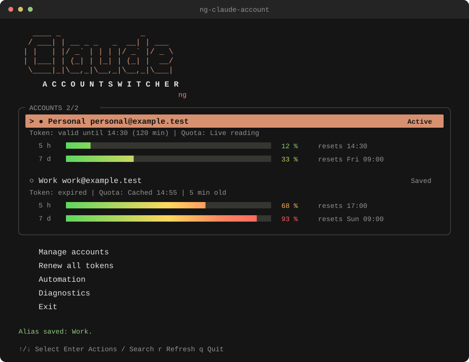

# Claude Account Switcher

**Multiple Claude accounts. One terminal. The same configuration.**

Switch accounts, compare usage, and maintain OAuth sessions without moving your
Claude Code settings, skills, plugins, or history. Use the keyboard-driven TUI or
call the same actions from your shell with **`ng-claude-account`**.

[](#requirements)
[](#requirements)
[](LICENSE)



*Interface illustration with fictional accounts. Percentages are quota used, not
quota remaining. Real values load in the background; dates and reset times use your
local timezone.*

[Install](#install) · [Quick start](#quick-start) · [TUI](#inside-the-tui) ·
[Commands](#command-reference) · [Automation](#optional-automation) ·
[How it works](#how-account-switching-works)

## What it does

| | |
|---|---|
| **Manage N accounts** | Add profiles, give them recognizable aliases, and cycle through authenticated accounts. |
| **Compare quota** | Five-hour and weekly usage bars with a green → yellow → orange → red gradient, plus reset times. |
| **Keep your setup** | The same Claude Code configuration, skills, plugins, and history stay in place when you switch. |
| **Follow external renewals** | Reconcile credentials renewed by Claude Code or OpenCode instead of restoring stale tokens. |
| **Renew sessions** | Refresh expired tokens individually or in bulk; optionally schedule daily renewal. |
| **Inspect and recover** | Offline diagnostics and restoration of saved profiles, with private backups of displaced credentials. |
| **Control automation** | Inspect, enable, or disable user timers directly from the TUI or CLI. |

## Requirements

- **Linux** and **Python 3.11+** with standard-library `curses` support.
- **Claude Code CLI** installed for browser login and optional scheduled prompts.
- **User systemd** for automation only; manual use works without it.
- No third-party Python packages.

macOS Keychain is not supported. OpenCode integration is designed around
`opencode-claude-auth`; credential reread and refresh-lock behavior was verified
against version 2.2.1. Other authentication plugins may behave differently.

## Install

```sh
git clone https://github.com/NauelG/Claude-Account-Switcher.git
cd Claude-Account-Switcher
python3 install.py
ng-claude-account
```

The installer places the executable in `~/.local/bin` with owner-only permissions,
installs documentation, and installs the user systemd units. If the command is not
found, add `~/.local/bin` to your shell's `PATH`.

**Automation is opt-in.** Installing does not enable either timer. Existing enabled
timers retain their activation state. On a host without systemd:

```sh
python3 install.py --no-systemd
```

To explicitly enable daily token renewal:

```sh
python3 install.py --enable-renewal
```

To also enable scheduled minimal prompts that attempt to stagger usage windows:

```sh
python3 install.py --enable-renewal --enable-windows
```

The window automation sends inference requests and consumes quota. It cannot
replenish quota or reset an already open window. See [optional automation](#optional-automation).

## Quick start

### 1. Register your current account

Already signed in through Claude Code? Reconcile and register that account:

```sh
ng-claude-account status
ng-claude-account alias principal Personal
```

Starting without an existing login? Use `ng-claude-account accounts add personal`.

### 2. Add another account

```sh
ng-claude-account accounts add work
ng-claude-account alias work Work
```

The login opens in an isolated configuration directory. It adds the new profile
without replacing the active account's settings or credentials.

### 3. Compare and switch

```sh
ng-claude-account           # Open the menu
ng-claude-account usage     # Or inspect quota from the shell
ng-claude-account switch work
```

`switch` without a name selects the next authenticated account in registry order.
With the verified OpenCode plugin, allow about 30 seconds for its credential cache
to pick up the change. Requests already in progress keep their existing token.

## Inside the TUI

The dashboard opens with the active account selected. Move directly between
accounts with the arrow keys and press Enter for actions on that account. Use `/`
to filter by alias, profile name, or email; matching is case-insensitive. Esc clears
an applied filter, and `q` exits.

Authentication and quota have separate labels: **Active**, **Saved**, **Login
required**, **Not registered**, or **Needs attention** describe the account. Token
expiry is not a quota reset. **Loading**, **Live reading**, **Cached HH:MM** with
age, and unavailable/error messages describe the quota reading.
Readings also become labeled as cached when the dashboard has been open long
enough for their freshness window to expire; press `r` to request an update.

**Enter on Work** opens its contextual actions:

```text
  CLAUDE ACCOUNT SWITCHER  ng

  Account actions
  Work (work) | work@example.test
  Account: Saved
  Access token: valid until 17:00 (120 min)
  Quota: Cached 14:55 | 5 min old

  > Switch to this account
    Account details
    Rename alias
    Renew token
    Log in / re-authenticate
    Restore credentials
    Remove profile
    Back

  Up/Down Move   Enter Select   Esc Back
```

Use **Manage accounts** to add or remove profiles, an account's **Rename alias**
action to change its display name, and **Automation** to inspect or toggle either timer. Removing an inactive
profile archives its credentials privately; an active profile must be switched
away from first.

The full dashboard adapts to terminal size. Small terminals use compact quota
rows; larger account lists are paginated instead of pushing actions off-screen.
Switching, renaming, and other successful actions return to the dashboard with a
short-lived notification. Errors stay visible; account actions remain available
for retrying, renewing, or logging in again.

| Key | Action |
|---|---|
| `↑` / `↓`, `j` / `k` | Move the selection |
| `Enter` | Open the selected action |
| `Esc`, `q` | Go back; exit from the main menu |
| `Tab` / `Shift+Tab` | Move forward / backward |
| `Home` / `End` | Select the first / last item |
| `Page Up` / `Page Down` | Scroll long account pickers |
| `[` / `]` | Previous / next account page on the compact dashboard |
| `r` | Refresh usage on the dashboard |
| `/` | Search accounts by alias, profile name or email |
| `Ctrl+C` | Cancel and restore the terminal |

Alias and search fields select their current text on entry. Type to replace it, or use
Left/Right, Home/End, Backspace and Delete to edit in place. `Ctrl+U` clears the
field. Validation stays inside the editor without discarding your input.

Set `NO_COLOR=1` for monochrome output. Terminals with 256 colors get an eight-step
usage gradient; basic color terminals use green, yellow, and red. Piped CLI output
contains no color escape sequences.

## Command reference

| Command | Purpose |
|---|---|
| `ng-claude-account` | Open the interactive menu |
| `status` | Reconcile credentials and inspect the active account |
| `accounts list` | List profiles and the current scheduling interval |
| `accounts add <name>` | Register and authenticate a profile |
| `accounts remove <name>` | Archive and remove an inactive profile |
| `switch [name]` | Select a profile, or cycle to the next one |
| `alias <name> <label>` | Set its display alias; quote labels containing spaces |
| `login <name>` | Reauthenticate an existing profile |
| `usage` | Show five-hour and weekly quota bars |
| `renew [--all]` | Renew expired tokens for the active account or all accounts |
| `doctor` | Diagnose the local credential layout without network access or writes |
| `repair <name>` | Restore a saved profile, preserving displaced credentials |
| `schedule status\|enable\|disable` | Control the usage-window timer |
| `schedule … --timer renewal` | Control the daily renewal timer |
| `schedule … --timer all` | Control both timers |

Prefix table entries with `ng-claude-account`. `--help` describes the available
arguments. `init` registers existing credentials; `prime-next` runs one scheduled
window turn only if it is due.

## Optional automation

The two timers do different things:

### Daily token renewal

```sh
ng-claude-account schedule enable --timer renewal
```

Renews expired access tokens for registered accounts. A valid token is left alone.
The active account uses the same file-refresh lock as the verified OpenCode plugin.
Renewing credentials does not make an inference request or open a usage window.

### Staggered usage-window prompts

```sh
ng-claude-account schedule enable --timer windows
```

Distributes account turns around the clock using **five hours ÷ N authenticated
profiles**:

| Accounts | Time between account turns | Each account gets a turn |
|---|---|---|
| 1 | 5 hours | Approximately every 5 hours |
| 2 | 2 hours 30 minutes | Approximately every 5 hours |
| 3 | 1 hour 40 minutes | Approximately every 5 hours |
| 4 | 1 hour 15 minutes | Approximately every 5 hours |

A lightweight timer checks due turns each minute. At an eligible turn, the tool
checks the account's actual reset time and sends one minimal Haiku prompt only if
there is no open five-hour window. It does not switch OpenCode's active account.

**This consumes some five-hour and weekly quota.** It cannot guarantee an exact
offset, zero usage, or additional quota. Existing activity, downtime, API delays,
rate limits, and skipped turns can change the schedule. Unknown usage state skips
the prompt; failures are not immediately retried.

### Inspect or stop automation

```sh
ng-claude-account schedule status --timer all
ng-claude-account schedule disable --timer windows
journalctl --user -u ng-claude-account-renew.service
journalctl --user -u ng-claude-account-window.service
```

User timers run without an open login session only when user lingering is enabled.
The **Automation** menu shows activation, last result, next run or account turn,
and remaining time. The account's next turn is displayed separately from the
timer's one-minute polling checks. Enable/Disable actions refresh that view in
place; failures remain visible with retry controls.

The installer does not change lingering. A oneshot service being `inactive`
between runs is normal; the timer is what must be `active`.

## How account switching works

```text
  Private profile store                   Claude / OpenCode
  ~/.local/share/claude-account/           ~/.claude/.credentials.json

  personal.json ─┐                         Regular active credential file
  work.json ─────┼── select / reconcile ──► Shared settings, skills and history
  lab.json ──────┘                         stay at their existing paths
```

Private runtime data stays in `${XDG_DATA_HOME:-~/.local/share}/claude-account`.
The active credential file remains at `~/.claude/.credentials.json`; it is a regular
file, because Claude Code atomically replaces this path when renewing tokens.
External renewals and direct logins are reconciled using the OAuth account UUID.
Settings, skills, and history are not switched.

If the live tokens change outside the tool, their account UUID is checked before
adopting them into a registered profile. Unknown or unverifiable credentials are
not silently assigned to a profile. Switching preserves shared non-Claude
credential sections, including MCP authentication.

The earlier dotfiles installation uses the same command and data paths. Moving to
this repository does not require another login or moving your profiles.

## Operational notes

OAuth refresh, profile verification, and quota queries rely on Anthropic endpoints
whose behavior can change. The usage endpoint is undocumented. A locally unexpired
token does not prove remaining quota or that authorization has not been revoked.

The quota endpoint may return HTTP 429. The tool respects `Retry-After`, shows the
last successful reading as cached when available, and keeps the rest of the menu
usable. Reading the current usage display is not a guarantee that a new request
will be accepted.

Never commit the credential store, metadata, quota caches, schedules, or archived
tokens. Only source, tests, documentation, and systemd definitions belong here.

## Development

```sh
make test
```

Tests use temporary homes, synthetic accounts, mocked HTTP responses, and a real
pseudo-terminal for keyboard and rendering behavior. They do not access real
accounts or require Anthropic network access. CI runs the same suites on Linux
with Python 3.11, 3.12, and 3.13.

- [Detailed command and behavior reference](docs/REFERENCE.md)
- [Consuming this project from dotfiles](docs/DOTFILES.md)
- [Changelog](CHANGELOG.md)

## License

[MIT](LICENSE)
